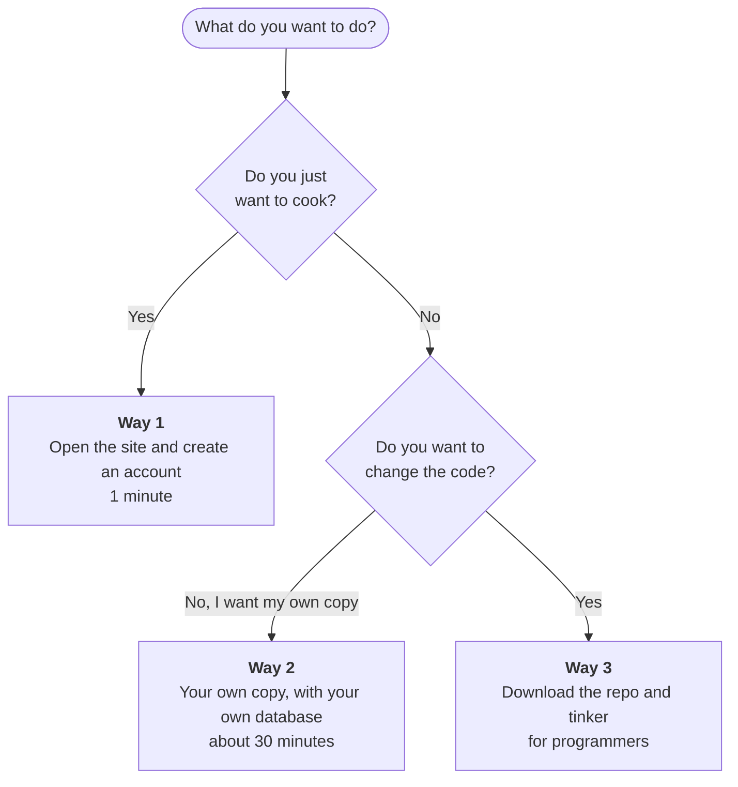

# 🍳 RecipeBox

**Your recipe book in your pocket: save the recipes you love and cook them step by step, even with floury hands.**

[🇮🇹 Italiano](README.md) · 🇬🇧 English

*Created by **Claudia**. Fixed up and published by **Federico**.*

---

## What is it?

RecipeBox is an app for your phone (and your computer) that keeps all your recipes in one place. Find the right one in a flash, cook it one step at a time, and when something is missing at home, your shopping list is already waiting for you.

You can install it on your phone like a real app, without going through an app store. The app itself is in Italian.

## 👥 Three ways to use RecipeBox

Pick the one that suits you:



| | **Way 1**<br>Use the site | **Way 2**<br>Have my own copy | **Way 3**<br>Tinker with the code |
|---|---|---|---|
| **Who it's for** | Just wants to cook, without thinking about the tech | Wants **their own** recipe collection and **their own** data, independent from the shared site | Wants to understand how it works, change it, make it theirs |
| **What you do** | Open the link and create an account | Install the app with your own database and put it online | Download the repository, modify it, run it on your computer |
| **What you need** | A browser or a phone | Free accounts on Supabase and Netlify, plus Node.js and Git | Programming skills (React, Supabase) |
| **Time** | 1 minute | about 30 minutes | up to you |
| **Cost** | Free | Free (on the free plans) | Free |
| **Your recipes** | Personal, on the shared site | In your own database | Wherever you like |
| **Go to** | [Way 1](#way-1-use-the-site) | [Way 2](#way-2-your-own-copy) | [Way 3](#way-3-tinker-with-the-code) |

The real difference between way 1 and way 2 is **who owns the data**: in way 1 your recipes live in the database of whoever runs the shared site (only you can see them in the app, but that person could technically see them); in way 2 they live in a space that is entirely yours.

## What can it do?

- 📚 **Base recipes for everyone, and your own personal ones**: the app starts with a ready-made collection; the recipes you add are visible only to you.
- 📖 **Your recipe archive**: starters, first courses, mains, sides, desserts and cocktails, with search and filters. One tap marks the ones you've already tried 👍
- 🥕 **"By ingredient"**: pick the ingredients you have in the fridge and instantly see the recipes that use them. Inside each recipe, "Cook with what you have" lets you tick what's already at home.
- 👩‍🍳 **Step-by-step guide**: every step has its own photo, and tapping a highlighted ingredient marks it as used.
- ⏱️ **Cooking timers**: start one right from the step and get a notification when it's time, even with the screen off.
- ⚖️ **Servings your way**: change the number of people and the quantities update on their own.
- ✨ **Add recipes effortlessly**: type them in, paste the link of a recipe you found online, or take a photo or upload a file. Artificial intelligence reads the text and builds the recipe card for you (see [With and without artificial intelligence](#-with-and-without-artificial-intelligence)).
- 🗓️ **Weekly planner**: breakfast, lunch and dinner for every day, with the option to duplicate a week.
- 🛒 **Shopping list**: generated from the recipes you picked. Tick items off as you shop, send the list to Bring!, or share it on WhatsApp.
- 📄 **Share a recipe** as a PDF.
- 🗑️ **Bin**: a recipe deleted by mistake can be restored within 7 days.
- 💶 **Keep an eye on costs**: a dedicated page shows the history of what the AI imports cost.

## ✨ With and without artificial intelligence

Part of the app uses artificial intelligence (Claude, by Anthropic), which has a cost for every request. That's why it is kept separate from the rest, and it is always clear what uses it: those menu items are marked with ✨.

| | Without AI | With AI |
|---|:---:|:---:|
| Archive, search, filters, "By ingredient" | ✅ | ✅ |
| Adding recipes **by hand** | ✅ | ✅ |
| Step-by-step guide, timers, servings | ✅ | ✅ |
| Weekly planner and shopping list | ✅ | ✅ |
| Importing a recipe from a **link** | – | ✅ |
| Importing a recipe from a **photo or PDF** | – | ✅ |

**How to turn AI on**

In the **Profile** page, paste your Anthropic key (create one at [console.anthropic.com](https://console.anthropic.com)). You pay for your imports, usually a few cents each. The key stays on your device only: it is not saved in the database and must be re-entered on each device. The app has no key of its own: nobody spends anybody else's money.

Without a key the import buttons don't show errors: they explain what's needed, and the rest of the app works normally.

## 📚 Base recipes and your own

- **Base recipes** are the collection the app starts with: the same for everyone and read-only (marked "Base" in the archive).
- **Recipes you add** are personal: only you can see them, edit them or delete them.
- In the archive you can pick **All**, **Mine** or **Base**.
- "**Already tried**" is personal: everyone marks their own, even on base recipes.
- Only whoever runs the app can add recipes to the base: a user cannot make their own recipes public.

## A tour of the app

### Finding the right recipe

<p align="center">
  
  &nbsp;&nbsp;
  
</p>

### Cooking step by step

<p align="center">
  
  &nbsp;
  
  &nbsp;
  
</p>

### Planning the week and shopping

<p align="center">
  
  &nbsp;&nbsp;
  
</p>

> The recipe photos in the screenshots belong to their respective authors and are shown only as examples.

---

## Way 1: use the site

**For those who just want to cook.** No technical knowledge needed and nothing to install.

1. Open **<https://yourrecipebox.netlify.app>**.
2. Create your account with an email and password (a confirmation email may arrive).
3. Done: the base recipes are already there, and you can add your own.

To have it on your phone like a real app:

- **Android (Chrome)**: menu ⋮ → *Install app* (or *Add to Home screen*).
- **iPhone (Safari)**: Share button → *Add to Home Screen*.

What you can do:

- use all the base recipes;
- add **your own recipes**: they are personal, only you can see them;
- import recipes from a link, photo or PDF with artificial intelligence, **if you want**, with your own Anthropic key (see [above](#-with-and-without-artificial-intelligence)). Without it, everything else works the same.

> It's a free service, run by one person and offered as is. Your recipes live in the shared site's database: if you want a space of your own, go to [Way 2](#way-2-your-own-copy).

---

## Way 2: your own copy

**For those who want their own collection and their own data, independent from the shared site.** You don't have to write code: just follow the steps. You need [Node.js](https://nodejs.org) (LTS version), [Git](https://git-scm.com) and two free accounts, on [Supabase](https://supabase.com) (stores recipes and users) and on [Netlify](https://www.netlify.com) (puts the app online). It takes about 30 minutes.

**1. Get the project**

```bash
git clone https://github.com/federico-bettin/RecipeBox.git
cd RecipeBox
npm install
```

**2. Create the database on Supabase**

1. On supabase.com, create a new project (pick a password and the region you prefer).
2. When it's ready, open **SQL Editor → New query**.
3. Paste the whole content of [`supabase/schema.sql`](supabase/schema.sql) and press **Run**. It creates the tables, the security rules and the photo bucket.

**3. Connect the app to your database**

In Supabase open **Project Settings → API** and copy two values: the *Project URL* and the public key (*Publishable key*, or the `anon` key in the "Legacy" tab). Then create the `.env.local` file:

```bash
# Windows
copy .env.example .env.local
# Mac / Linux
cp .env.example .env.local
```

Open it and paste the two values:

```
VITE_SUPABASE_URL=https://xxxxxxxxxxxx.supabase.co
VITE_SUPABASE_ANON_KEY=your-public-key
```

**4. Try it on your computer**

```bash
npm run dev
```

Open the address that appears (usually <http://localhost:5173>), sign up and add your first recipe. 🎉

> **If sign-up doesn't work:** in Supabase, **Authentication → URL Configuration**, set *Site URL* to `http://localhost:5173`. To try things right away without waiting for the confirmation email, you can turn off *Confirm email* in **Authentication → Sign In / Providers → Email**.

**5. Put it online, to use it from your phone**

1. Create the version to publish: `npm run build`. This creates the `dist` folder.
2. On app.netlify.com choose **Add new project → Deploy manually** and drop the `dist` folder in.
3. Netlify gives you an address (`https://something.netlify.app`). In Supabase, **Authentication → URL Configuration**, set it as the *Site URL* and in the *Redirect URLs*.

Now you can open that address on your phone and install the app as in [Way 1](#way-1-use-the-site).

**With these steps** the archive, search, step-by-step guide, weekly planner and shopping list work. The extra features (**import from a link or photo**, which each user turns on with their own Anthropic key, and **timer notifications**) require deploying the server functions and a few more steps: you'll find them in [docs/DEVELOPMENT.md](docs/DEVELOPMENT.md).

---

## Way 3: tinker with the code

**For programmers who want to change, extend or study RecipeBox.** It's built with React, Vite and Supabase.

```bash
git clone https://github.com/federico-bettin/RecipeBox.git
cd RecipeBox
npm install
cp .env.example .env.local     # then fill in the two values: see Way 2, steps 2 and 3
npm run dev
```

Useful commands: `npm run dev` (development), `npm run build` (production build), `npm run lint` (code checks), `npm run preview` (try the production build).

How the project is organized:

```
src/
  pages/        the screens (Home, Archive, Recipe, Planner, Profile…)
  components/   shared components
  lib/          Supabase, artificial intelligence, notifications, ingredients
  sw.js         service worker: offline cache and push notifications
supabase/
  schema.sql    complete database schema
  migrations/   schema changes over time
  functions/    server functions (AI imports, notifications)
docs/           technical guides and screenshots
```

The technical guides (functions, secrets, base and personal recipes, deployment) are in [docs/DEVELOPMENT.md](docs/DEVELOPMENT.md). If you find a problem or have an idea, open an *issue* on GitHub.

---

## 💛 Credits

RecipeBox was conceived and created by **Claudia**. **Federico Bettin** fixed it up and published it on GitHub.

---

## License

[MIT](LICENSE): use it, change it and share it freely.
