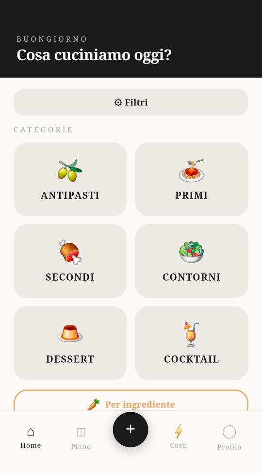
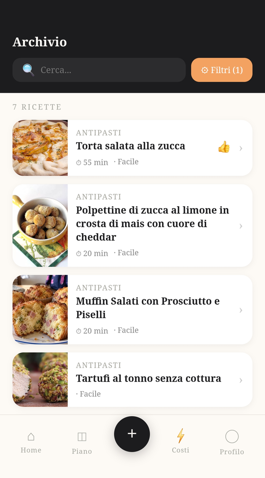
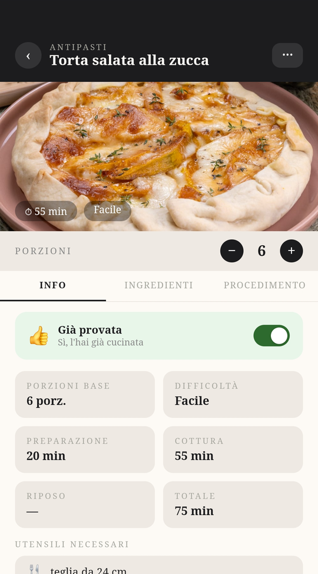
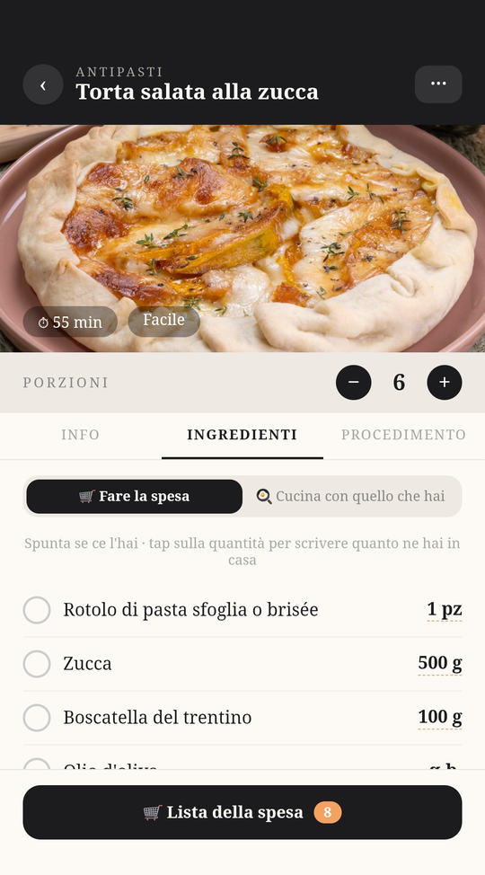
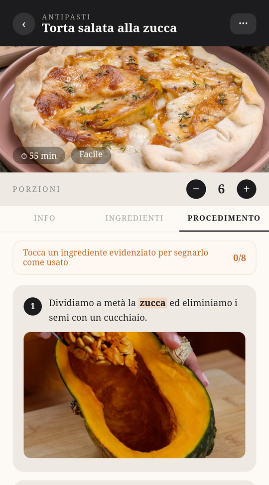
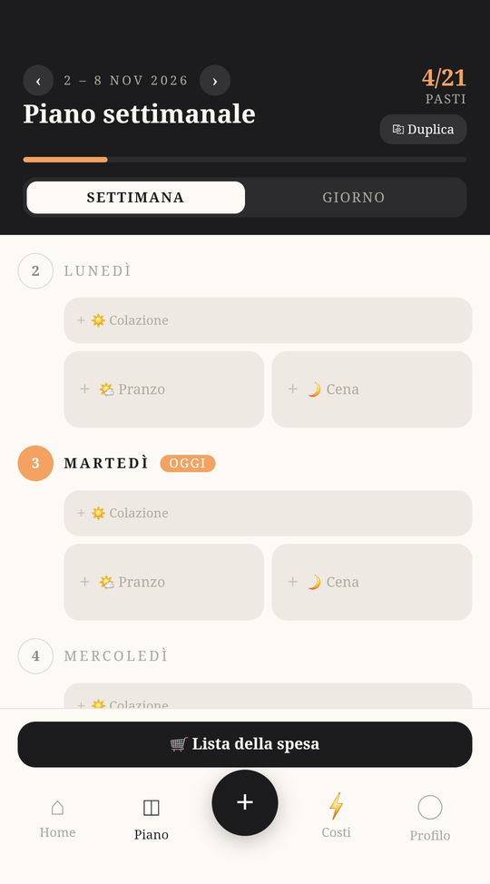
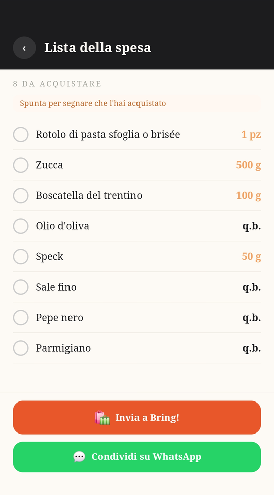

# 🍳 RecipeBox

**Your recipe book in your pocket: save the recipes you love and cook them step by step, even with floury hands.**

[🇮🇹 Italiano](README.md) · 🇬🇧 English

---

## What is it?

RecipeBox is an app for your phone (and your computer) that keeps all your recipes in one place. Find the right one in a flash, cook it one step at a time, and when something is missing at home, your shopping list is already waiting for you.

You can install it on your phone like a real app, without going through an app store.

> The app itself is in Italian.

## What can it do?

- 📚 **Base recipes for everyone, and your own personal ones**: the app starts with a ready-made collection; the recipes you add are visible only to you.
- 📖 **Your recipe archive**: starters, first courses, mains, sides, desserts and cocktails, with search and filters. One tap marks the ones you've already tried 👍
- 🥕 **"By ingredient"**: pick the ingredients you have in the fridge and instantly see the recipes that use them. Inside each recipe, "Cook with what you have" lets you tick what's already at home.
- 👩‍🍳 **Step-by-step guide**: every step has its own photo, and tapping a highlighted ingredient marks it as used.
- ⏱️ **Cooking timers**: start one right from the step and get a notification when it's time, even with the screen off.
- ⚖️ **Servings your way**: change the number of people and the quantities update on their own.
- ✨ **Add recipes effortlessly**: type them in, paste the link of a recipe you found online, or take a photo or upload a file. Artificial intelligence reads the text and builds the recipe card for you (see [With and without artificial intelligence](#-with-and-without-artificial-intelligence)).
- 🗓️ **Weekly planner**: breakfast, lunch and dinner for every day, with the option to duplicate a week.
- 🛒 **Shopping list**: generated from the recipes you picked. Tick items off as you shop, send the list to Bring!, or share it on WhatsApp.
- 📄 **Share a recipe** as a PDF.
- 🗑️ **Bin**: a recipe deleted by mistake can be restored within 7 days.
- 💶 **Keep an eye on costs**: a dedicated page shows how much the AI imports cost.

## ✨ With and without artificial intelligence

Part of the app uses artificial intelligence (Claude, by Anthropic), which has a cost for every request. That's why it is kept separate from the rest, and it is always clear what uses it: those menu items are marked with ✨.

| | Without AI | With AI |
|---|:---:|:---:|
| Archive, search, filters, "By ingredient" | ✅ | ✅ |
| Adding recipes **by hand** | ✅ | ✅ |
| Step-by-step guide, timers, servings | ✅ | ✅ |
| Weekly planner and shopping list | ✅ | ✅ |
| Importing a recipe from a **link** | – | ✅ |
| Importing a recipe from a **photo or PDF** | – | ✅ |

**How to turn AI on**

In the **Profile** page, paste your Anthropic key (create one at [console.anthropic.com](https://console.anthropic.com)). You pay for your imports, usually a few cents each. The key stays on your device only: it is not saved in the database and must be re-entered on each device. The app has no key of its own: nobody spends anybody else's money.

Without a key the import buttons don't show errors: they explain what's needed, and the rest of the app works normally.

## 📚 Base recipes and your own

- **Base recipes** are the collection the app starts with: the same for everyone and read-only (marked "Base" in the archive).
- **Recipes you add** are personal: only you can see them, edit them or delete them.
- In the archive you can pick **All**, **Mine** or **Base**.
- "**Already tried**" is personal: everyone marks their own, even on base recipes.
- Only whoever runs the app can add recipes to the base: a user cannot make their own recipes public.

## A tour of the app

### Finding the right recipe

<p align="center">
  
  &nbsp;&nbsp;
  
</p>

### Cooking step by step

<p align="center">
  
  &nbsp;
  
  &nbsp;
  
</p>

### Planning the week and shopping

<p align="center">
  
  &nbsp;&nbsp;
  
</p>

> The recipe photos in the screenshots belong to their respective authors and are shown only as examples.

## 🚀 Install it and try it

You need three things, all free: [Node.js](https://nodejs.org) (LTS version), [Git](https://git-scm.com) and an account on [Supabase](https://supabase.com), the service that stores recipes and users. It takes about 10 minutes.

**1. Get the project**

```bash
git clone https://github.com/federico-bettin/RecipeBox.git
cd RecipeBox
npm install
```

**2. Create the database on Supabase**

1. On supabase.com, create a new project (pick a password and the region you prefer).
2. When it's ready, open **SQL Editor → New query**.
3. Paste the whole content of [`supabase/schema.sql`](supabase/schema.sql) and press **Run**. It creates the tables, the security rules and the photo bucket.

**3. Connect the app to your database**

In Supabase open **Project Settings → API** and copy two values: the *Project URL* and the public key (*Publishable key*, or the `anon` key in the "Legacy" tab). Then create the `.env.local` file:

```bash
# Windows
copy .env.example .env.local
# Mac / Linux
cp .env.example .env.local
```

Open it and paste the two values:

```
VITE_SUPABASE_URL=https://xxxxxxxxxxxx.supabase.co
VITE_SUPABASE_ANON_KEY=your-public-key
```

**4. Start the app**

```bash
npm run dev
```

Open the address that appears (usually <http://localhost:5173>), sign up and start adding recipes. 🎉

> **If sign-up doesn't work:** in Supabase, **Authentication → URL Configuration**, set *Site URL* to `http://localhost:5173`. To try things right away without waiting for the confirmation email, you can turn off *Confirm email* in **Authentication → Sign In / Providers → Email**.

With these steps the archive, search, step-by-step guide, weekly planner and shopping list already work. The extra features (**import from a link or photo**, which each user turns on with their own Anthropic key, and **timer notifications**) require deploying the server functions and a few more steps: you'll find them in [docs/DEVELOPMENT.md](docs/DEVELOPMENT.md), together with how to publish the site online.

## For tinkerers

RecipeBox is built with React, Vite and Supabase. Advanced setup, functions and deployment are explained in [docs/DEVELOPMENT.md](docs/DEVELOPMENT.md).

## License

[MIT](LICENSE): use it, change it and share it freely.
