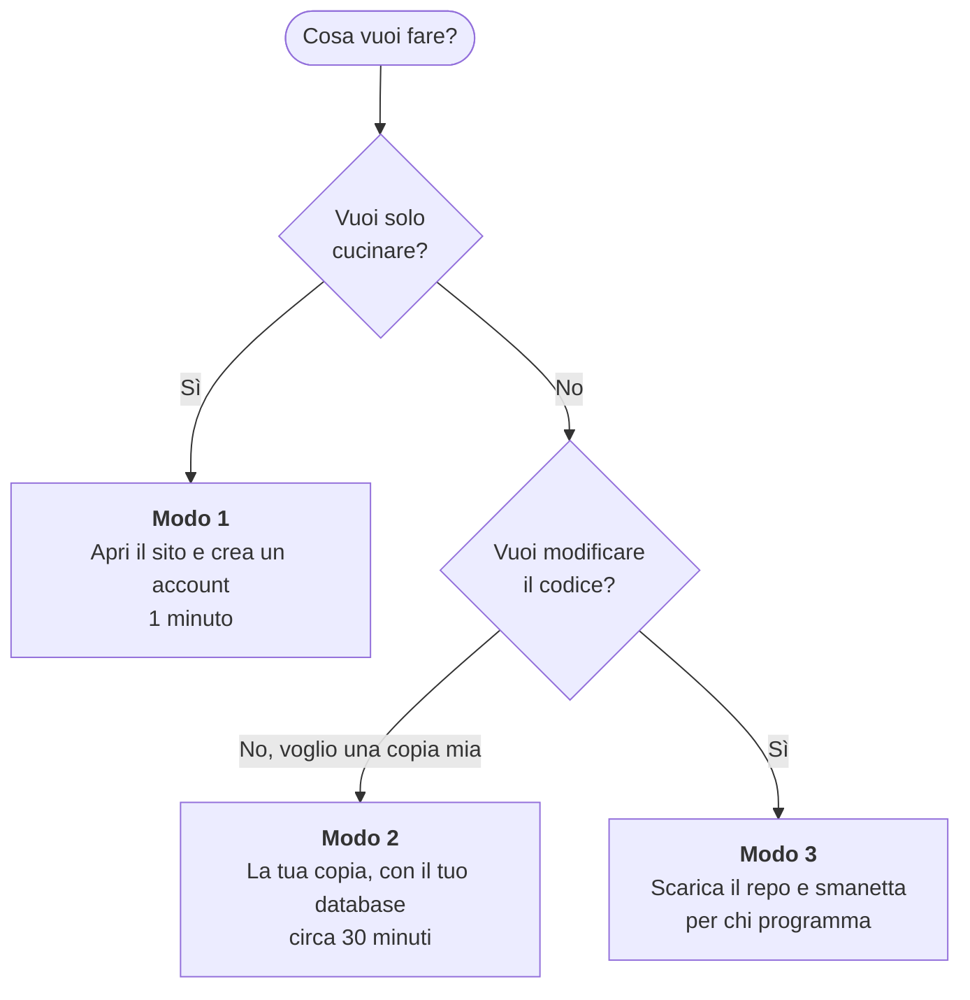
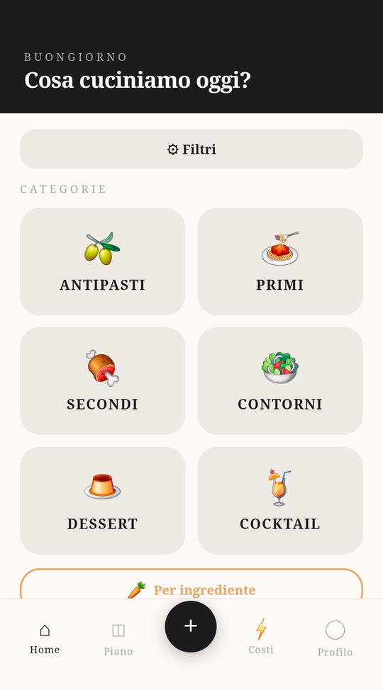
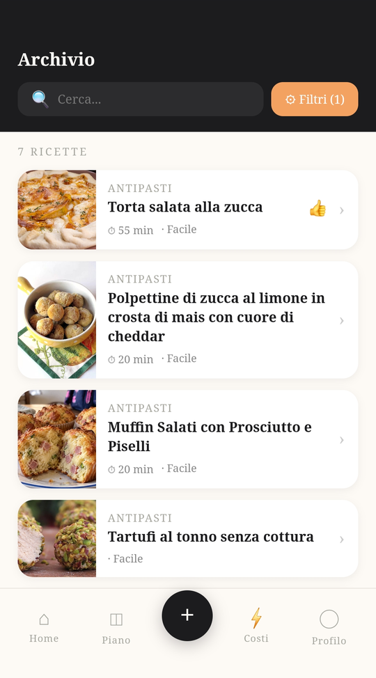
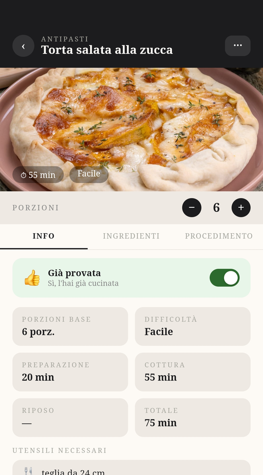
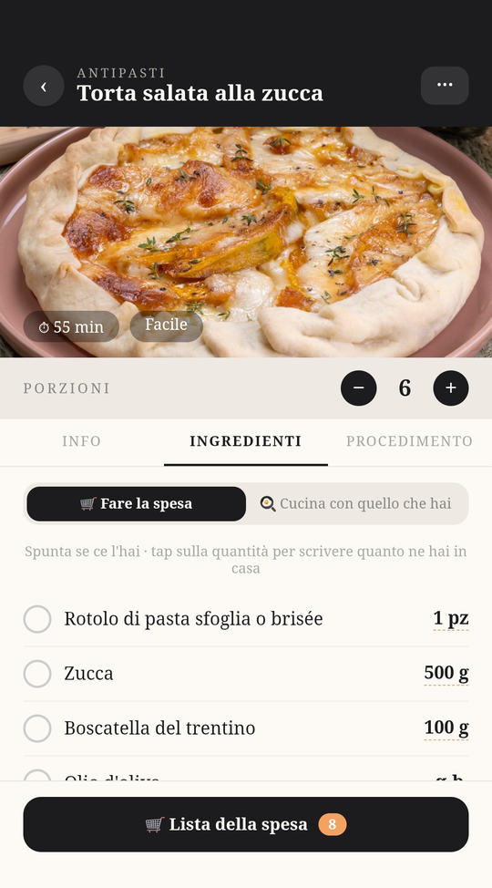
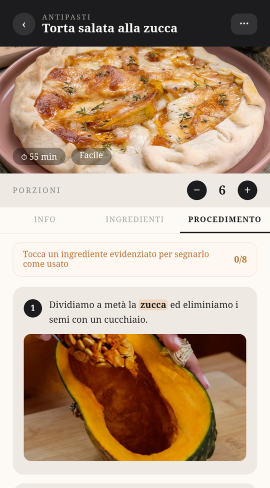
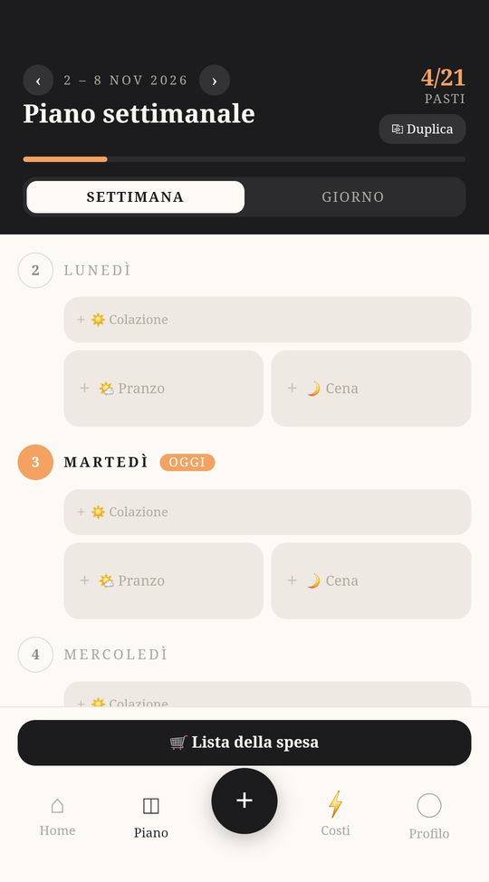
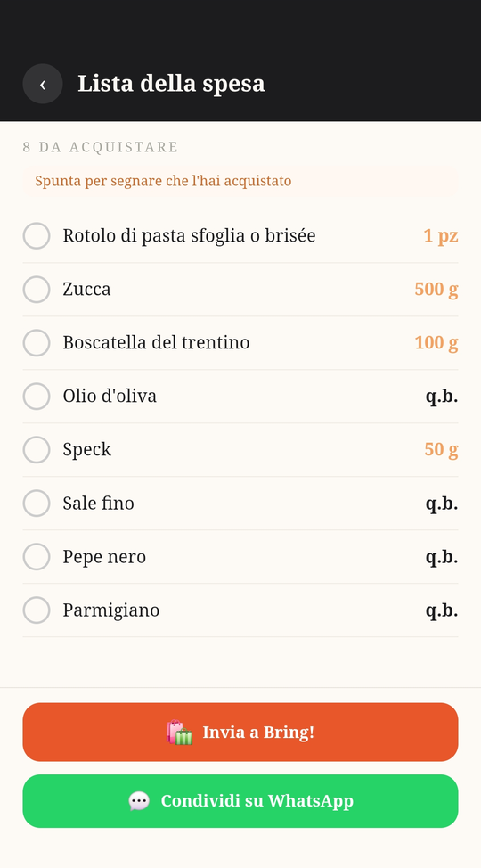

# 🍳 RecipeBox

**Il tuo ricettario in tasca: salva le ricette che ti piacciono e cucinale passo passo, anche con le mani infarinate.**

🇮🇹 Italiano · [🇬🇧 English](README.en.md)

*Ideata e creata da **Claudia**. Sistemata e pubblicata da **Federico**.*

---

## Cos'è

RecipeBox è un'app per il telefono (e per il computer) che raccoglie tutte le tue ricette in un unico posto. Trovi al volo quella giusta, la cucini seguendo i passaggi uno alla volta, e quando manca qualcosa in casa la lista della spesa è già pronta.

Si installa sul telefono come una vera app, senza passare dallo store. L'app è in italiano.

## 👥 Tre modi di usare RecipeBox

Scegli quello che fa per te:



| | **Modo 1**<br>Uso il sito | **Modo 2**<br>Ho una copia mia | **Modo 3**<br>Smanetto sul codice |
|---|---|---|---|
| **Per chi è** | Vuole solo cucinare, senza pensare alla tecnica | Vuole la **sua** raccolta di ricette e i **suoi** dati, indipendenti dal sito condiviso | Vuole capire com'è fatta, modificarla, farla propria |
| **Cosa fa** | Apre il link e crea un account | Installa l'app con un suo database e la mette online | Scarica il repository, lo modifica, lo prova sul suo computer |
| **Cosa serve** | Un browser o un telefono | Account gratuiti su Supabase e Netlify, più Node.js e Git | Conoscenze di programmazione (React, Supabase) |
| **Tempo** | 1 minuto | circa 30 minuti | dipende da te |
| **Costo** | Gratis | Gratis (con i piani gratuiti) | Gratis |
| **Le sue ricette** | Personali, sul sito condiviso | Nel suo database | Dove preferisce |
| **Vai a** | [Modo 1](#modo-1-usa-il-sito) | [Modo 2](#modo-2-la-tua-copia) | [Modo 3](#modo-3-smanetta-sul-codice) |

La differenza vera tra il modo 1 e il modo 2 è **di chi sono i dati**: nel modo 1 le tue ricette stanno sul database di chi gestisce il sito condiviso (sono visibili solo a te nell'app, ma quella persona potrebbe tecnicamente vederle); nel modo 2 stanno in uno spazio tutto tuo.

## Cosa sa fare

- 📚 **Ricette di base per tutti, e le tue personali**: l'app parte con una raccolta pronta; le ricette che aggiungi tu le vedi solo tu.
- 📖 **Il tuo archivio di ricette**: antipasti, primi, secondi, contorni, dessert e cocktail, con ricerca e filtri. Con un tocco segni quelle che hai già provato 👍
- 🥕 **"Per ingrediente"**: scegli gli ingredienti che hai in frigo e vedi subito le ricette che li usano. In ogni ricetta, "Cucina con quello che hai" ti fa spuntare cosa hai già in casa.
- 👩‍🍳 **Guida passo passo**: ogni passaggio ha la sua foto, e toccando un ingrediente evidenziato lo segni come usato.
- ⏱️ **Timer di cottura**: parte dal passaggio e ti avvisa con una notifica quando è ora, anche con lo schermo spento.
- ⚖️ **Porzioni a piacere**: cambi il numero di persone e le quantità si ricalcolano da sole.
- ✨ **Aggiungi ricette senza fatica**: scrivile a mano, incolla il link di una ricetta trovata sul web, oppure scatta una foto o carica un file. L'intelligenza artificiale legge il testo e prepara la scheda al posto tuo (vedi [Con e senza intelligenza artificiale](#-con-e-senza-intelligenza-artificiale)).
- 🗓️ **Piano settimanale**: colazione, pranzo e cena di ogni giorno, con la possibilità di duplicare la settimana.
- 🛒 **Lista della spesa**: generata dalle ricette che hai scelto. La spunti mentre fai la spesa, la mandi a Bring! o la condividi su WhatsApp.
- 📄 **Condividi una ricetta** in PDF.
- 🗑️ **Cestino**: una ricetta eliminata per sbaglio si recupera entro 7 giorni.
- 💶 **Occhio ai costi**: una pagina dedicata mostra lo storico dei costi delle importazioni con l'intelligenza artificiale.

## ✨ Con e senza intelligenza artificiale

Una parte dell'app usa l'intelligenza artificiale (Claude, di Anthropic), che ha un costo per ogni richiesta. Per questo è tenuta separata dal resto, e si capisce sempre cosa la usa: nei menu quelle voci hanno il simbolo ✨.

| | Senza AI | Con AI |
|---|:---:|:---:|
| Archivio, ricerca, filtri, "Per ingrediente" | ✅ | ✅ |
| Aggiungere ricette **a mano** | ✅ | ✅ |
| Guida passo passo, timer, porzioni | ✅ | ✅ |
| Piano settimanale e lista della spesa | ✅ | ✅ |
| Importare una ricetta da un **link** | – | ✅ |
| Importare una ricetta da una **foto o un PDF** | – | ✅ |

**Come si attiva l'AI**

Nel **Profilo** incolli la tua chiave Anthropic (la crei su [console.anthropic.com](https://console.anthropic.com)). Le importazioni le paghi tu, di solito pochi centesimi l'una. La chiave resta solo sul tuo dispositivo: non viene salvata nel database e va reinserita su ogni dispositivo. L'app non ha una chiave sua: nessuno spende i soldi di qualcun altro.

Senza chiave i pulsanti di importazione non danno errori ma spiegano cosa serve, e tutto il resto dell'app funziona normalmente.

## 📚 Ricette di base e ricette tue

- Le **ricette di base** sono la raccolta con cui l'app parte: sono uguali per tutti e in sola lettura (nell'Archivio hanno l'etichetta "Base").
- Le **ricette che aggiungi tu** sono personali: le vedi solo tu e puoi modificarle o eliminarle.
- Nell'Archivio puoi scegliere **Tutte**, **Le mie** o **Base**.
- "**Già provata**" è personale: ognuno segna le sue, anche sulle ricette di base.
- Solo chi gestisce l'app può aggiungere ricette alla base: un utente non può rendere pubbliche le proprie.

## Un giro nell'app

### Trovare la ricetta giusta

<p align="center">
  
  &nbsp;&nbsp;
  
</p>

### Cucinare passo passo

<p align="center">
  
  &nbsp;
  
  &nbsp;
  
</p>

### Organizzare la settimana e fare la spesa

<p align="center">
  
  &nbsp;&nbsp;
  
</p>

> Le foto delle ricette negli screenshot appartengono ai rispettivi autori e sono mostrate solo a titolo di esempio.

---

## Modo 1: usa il sito

**Per chi vuole solo cucinare.** Non serve sapere nulla di informatica e non si installa niente.

1. Apri **<https://yourrecipebox.netlify.app>**.
2. Crea il tuo account con email e password (potrebbe arrivare un'email di conferma).
3. Fatto: trovi già le ricette di base, e puoi aggiungere le tue.

Per averla sul telefono come una vera app:

- **Android (Chrome)**: menu ⋮ → *Installa app* (o *Aggiungi a schermata Home*).
- **iPhone (Safari)**: tasto Condividi → *Aggiungi alla schermata Home*.

Cosa puoi fare:

- usare tutte le ricette di base;
- aggiungere le **tue ricette**: sono personali, le vedi solo tu;
- importare ricette da link, foto o PDF con l'intelligenza artificiale, **se vuoi**, con la tua chiave Anthropic (vedi [sopra](#-con-e-senza-intelligenza-artificiale)). Senza, il resto funziona uguale.

> È un servizio gratuito, gestito da una sola persona e offerto così com'è. Le tue ricette stanno sul database del sito condiviso: se vuoi un tuo spazio indipendente, passa al [Modo 2](#modo-2-la-tua-copia).

---

## Modo 2: la tua copia

**Per chi vuole la sua raccolta e i suoi dati, indipendenti dal sito condiviso.** Non devi scrivere codice: segui i passi. Ti servono [Node.js](https://nodejs.org) (versione LTS), [Git](https://git-scm.com) e due account gratuiti, su [Supabase](https://supabase.com) (conserva ricette e utenti) e su [Netlify](https://www.netlify.com) (mette l'app online). Ci vogliono circa 30 minuti.

**1. Scarica il progetto**

```bash
git clone https://github.com/federico-bettin/RecipeBox.git
cd RecipeBox
npm install
```

**2. Crea il database su Supabase**

1. Su supabase.com crea un nuovo progetto (scegli una password e la regione che preferisci).
2. Quando è pronto, apri **SQL Editor → New query**.
3. Incolla tutto il contenuto del file [`supabase/schema.sql`](supabase/schema.sql) e premi **Run**. Crea le tabelle, le regole di sicurezza e la cartella per le foto.

**3. Collega l'app al tuo database**

In Supabase apri **Project Settings → API** e copia due valori: il *Project URL* e la chiave pubblica (*Publishable key*, oppure la chiave `anon` nella scheda "Legacy"). Poi crea il file `.env.local`:

```bash
# Windows
copy .env.example .env.local
# Mac / Linux
cp .env.example .env.local
```

Aprilo e incolla i due valori:

```
VITE_SUPABASE_URL=https://xxxxxxxxxxxx.supabase.co
VITE_SUPABASE_ANON_KEY=la-tua-chiave-pubblica
```

**4. Provala sul tuo computer**

```bash
npm run dev
```

Apri l'indirizzo che compare (di solito <http://localhost:5173>), registrati e aggiungi la tua prima ricetta. 🎉

> **Se la registrazione non funziona:** in Supabase, **Authentication → URL Configuration**, imposta *Site URL* su `http://localhost:5173`. Per provare subito senza aspettare l'email di conferma, puoi disattivare *Confirm email* in **Authentication → Sign In / Providers → Email**.

**5. Mettila online, per usarla dal telefono**

1. Crea la versione da pubblicare: `npm run build`. Nasce la cartella `dist`.
2. Su app.netlify.com scegli **Add new project → Deploy manually** e trascina dentro la cartella `dist`.
3. Netlify ti dà un indirizzo (`https://qualcosa.netlify.app`). In Supabase, **Authentication → URL Configuration**, mettilo come *Site URL* e tra i *Redirect URLs*.

Ora puoi aprire quell'indirizzo dal telefono e installare l'app come nel [Modo 1](#modo-1-usa-il-sito).

**Con questi passi funzionano** archivio, ricerca, guida passo passo, piano settimanale e lista della spesa. Le funzioni extra (**importa da link o foto**, che ogni utente attiva con la propria chiave Anthropic, e **notifiche dei timer**) richiedono di pubblicare le funzioni sul server e qualche passaggio in più: li trovi in [docs/SVILUPPO.md](docs/SVILUPPO.md).

---

## Modo 3: smanetta sul codice

**Per chi programma e vuole modificare, estendere o studiare RecipeBox.** È fatta con React, Vite e Supabase.

```bash
git clone https://github.com/federico-bettin/RecipeBox.git
cd RecipeBox
npm install
cp .env.example .env.local     # poi compila i due valori: vedi Modo 2, passi 2 e 3
npm run dev
```

Comandi utili: `npm run dev` (sviluppo), `npm run build` (versione di produzione), `npm run lint` (controlli sul codice), `npm run preview` (prova la versione di produzione).

Com'è organizzato il progetto:

```
src/
  pages/        le schermate (Home, Archivio, Ricetta, Piano, Profilo…)
  components/   componenti condivisi
  lib/          Supabase, intelligenza artificiale, notifiche, ingredienti
  sw.js         service worker: cache offline e notifiche push
supabase/
  schema.sql    schema completo del database
  migrations/   modifiche allo schema nel tempo
  functions/    funzioni sul server (importazioni con AI, notifiche)
docs/           guide tecniche e screenshot
```

Le guide tecniche (funzioni, segreti, ricette di base e personali, pubblicazione) sono in [docs/SVILUPPO.md](docs/SVILUPPO.md). Se trovi un problema o hai un'idea, apri una *issue* su GitHub.

---

## 💛 Crediti

RecipeBox è stata ideata e creata da **Claudia**. **Federico Bettin** l'ha sistemata e pubblicata su GitHub.

---

## Licenza

[MIT](LICENSE): puoi usarla, modificarla e condividerla liberamente.
